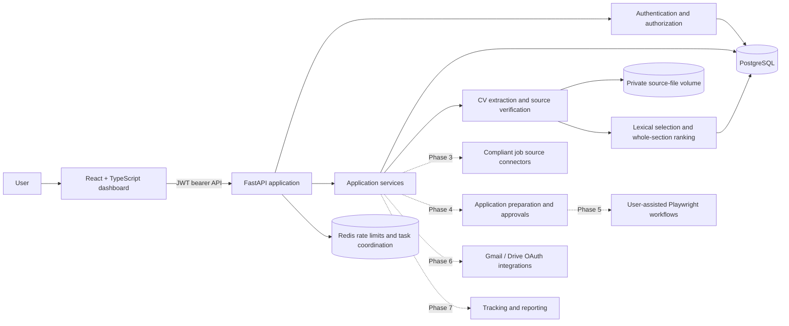
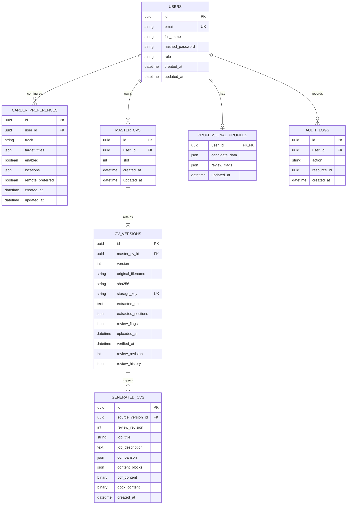
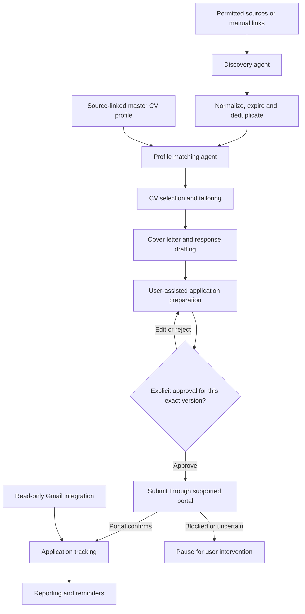

# Architecture and phased delivery

## Phase 1 and Phase 2 implementation

The platform foundation includes a FastAPI API, PostgreSQL persistence, Alembic migrations, Redis-backed rate limiting, email/password authentication, a React/TypeScript workspace, and per-user career preferences for three separate tracks. Phase 2 adds two versioned CV source slots, extraction, explicit owner verification/revocation, source-linked profile evidence, lexical CV selection, whole-section ranking, and stored PDF/DOCX snapshots with comparison history. The dashboard identifies later phases as planned; it does not display fabricated jobs, applications, or integrations.

## System architecture

### Key decisions and boundaries

- **Persistence:** SQLAlchemy 2 models use UUID primary keys and Alembic migrations. SQLite is the local Python default for lightweight tests; Docker Compose uses PostgreSQL. Production configuration rejects SQLite, in-memory rate-limit storage, and the built-in development key.
- **Authentication:** Accounts use Argon2 password hashes and short-lived HS256 bearer tokens. Tokens are held in frontend memory, not local storage. API access is protected by user identity; registration is rate limited. Shared Redis is used by Compose for rate-limit state.
- **Career tracks:** Software engineering, cybersecurity, and electrical engineering preferences are separate rows with independent target titles and search settings.
- **Trust boundary:** External job text, documents, and email will be treated as untrusted data. Later agent workflows must keep system policy separate from retrieved content and gate consequential actions in server-side approval records.
- **Application submissions:** No job-board connectors, document processing, email sending, or application submission are implemented in Phase 1. Later submission must bind approval to an immutable application version and require fresh approval after material edits.
- **Integrations:** Job-board support depends on official APIs, permitted feeds, or user-assisted/manual imports. OAuth client credentials and Google API scopes are deployment-specific and are not claimed as connected.
- **Frontend:** The React dashboard is a functional registration/sign-in shell that reads the authenticated account and its saved career preferences. Additional navigation is visibly marked as planned rather than represented as working features.
- **CV evidence:** Two per-user slots retain immutable source versions and SHA-256 hashes. PDF/DOCX MIME claims are not trusted; signatures/archive structure and upload size are checked. The parser extracts selectable text and recognized section headings without synthesizing facts. Source-linked reviews append snapshots to `review_history` under a monotonically increasing revision, retaining text/section/order, original line references, exclusions, owner reason and timestamp. Every source line must be included or excluded exactly once. Originals/raw extraction are never edited. PostgreSQL row locks and expected-revision checks serialize edits against verification/generation. Verification requires explicit owner confirmation of matching source hash and current review revision; saved reviews/replacements start unverified. Profile evidence uses effective reviewed entries and exposes the contributing review revisions; reads rebuild effective evidence so legacy verification cannot mask quality findings.
- **CV quality:** Conservative signals cover known sample contacts, replacement characters, widely spaced text, repeated lines/headings, multiple emails, future years and percentages. Unedited sources with signals require a saved human review. Saved reviews can acknowledge soft findings, but remaining known sample markers/damaged replacement characters block verification and generation. These checks also gate legacy exports. They cannot establish identity or infer true qualifications/dates, and never silently delete content.
- **CV generation:** Only verified current sources passing quality gates are eligible. Reviewed content replaces raw text for keyword selection and rendering; deterministic overlap selects a source (ties favor slot 1), and zero overlap fails visibly. Canonical sections are assembled from owner-assigned entries, then complete sections ranked by overlap, retaining entry order. Owners must group associated employer/role/date/bullets in multiline entries if raw reading order is damaged. Comparison history identifies the review revision, correction references, exclusions and output-only nonprinting-control cleanup. Docker embeds DejaVu/Symbola fallback fonts with UTF-16BE supplementary-symbol mappings. This is conservative lexical tailoring, not semantic matching or AI rewriting.
- **CV data retention:** Files live under generated storage keys outside the web root, backed by a Docker volume. Immutable PDF/DOCX snapshots link to source version and review revision. Revocation blocks downloads; review edits make old-revision exports stale even after reverification. History/preview remain available for provenance, but downloaded files cannot be retracted. Deleting a slot removes source versions, reviews, files, snapshots and derived profile evidence. Backups and deployment-level storage encryption remain operator responsibilities.
- **Audit:** Review saves, verification, revocation and generation write audit records in the same transaction. Audit records contain actor ID, action, resource ID and timestamp, not CV text or credentials; private source review history separately retains reviewed CV text and owner notes.

## Database ER diagram (implemented scope)

Each candidate profile evidence entry contains its effective source/reviewed text, source version ID(s), source CV slot(s), contributing review revisions and verification state. The source review editor can correct/exclude/reorder text without normalizing employment, education, skills, certifications and projects into domain entities. Verification records owner review, not an external credential check. Vacancy records and matches are introduced in Phase 3, with application/approval and communication history in subsequent phases.

## Multi-agent workflow (target design)

Automated discovery, analysis, document preparation, and email classification are non-committing actions. Submitting, sending email, making declarations, accepting offers, or sharing sensitive documents require explicit user approval.

## Planned implementation phases

| Phase | Scope |
|---|---|
| 1 — Foundation | Project architecture, API, database/migrations, authentication, dashboard shell, environment and Docker. Implemented. |
| 2 — Profile and CV intelligence | Uploads, extraction, source-linked profile, verification/revocation, lexical source selection, whole-section ranking, saved PDF/DOCX versions, comparisons and audit records implemented. Fine-grained normalized editing and LLM summary/skills rewriting remain deferred. |
| 3 — Discovery and matching | Permitted connectors/manual import, normalization, deduplication, suitability evaluation and ranked dashboard. |
| 4 — Application preparation | Grounded letters and answers, unresolved declaration prompts, edit/preview and immutable approval records. |
| 5 — Browser automation | Supported Playwright workflows, form completion, user intervention and verified submission outcomes. |
| 6 — Google integration | Least-privilege OAuth, Gmail classification, approved replies, Drive organization; calendar optional. |
| 7 — Tracking and analytics | Application lifecycle, interviews, metrics, notifications and reports. |
| 8 — Deployment hardening | Full test coverage, security review, production deployment and operational runbooks. |

## Integration and operational limitations

- LinkedIn, Indeed, and other job services may restrict automated access. Only supported APIs, feeds, or user-assisted workflows will be used; CAPTCHA, MFA, rate limits, and access controls will not be bypassed.
- Gmail/Drive require OAuth consent configuration, redirect URLs, and Google Cloud credentials. Tokens must be encrypted at rest before persistent integration is enabled.
- Portal forms vary; automation must stop when a portal blocks it, requests unsupported verification, or presents a sensitive declaration.
- The Compose setup is for local development. Production requires managed secrets, TLS, backups, controlled origins, a durable Redis service, and an operational deployment target.
